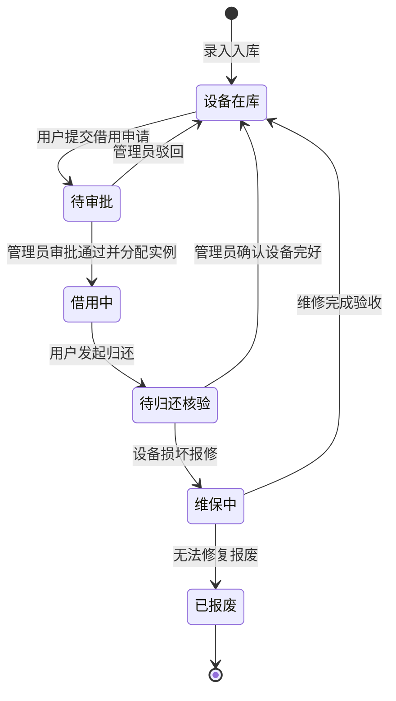

<div align="center">

# 📷 光影资产 (DeviceManage)

<p align="center">
  <strong>基于 Spring Boot 3 与现代响应式架构的媒体设备全生命周期资产管理平台</strong><br>
  <em>Media Equipment Asset Lifecycle & Borrowing Management Platform with Spring Boot 3, MyBatis-Plus & Role-Based Access Control</em>
</p>

[](LICENSE)
[](https://www.oracle.com/java/)
[](https://spring.io/projects/spring-boot)
[](https://baomidou.com/)
[](https://www.mysql.com/)
[](https://jwt.io/)
[](https://github.com/KissFeng/device-manage/pulls)

**简体中文** | [English](./README_EN.md)

</div>

---

## 📑 目录

- [💡 为什么选择光影资产？](#-为什么选择光影资产)
- [✨ 核心特性矩阵与功能全景](#-核心特性矩阵与功能全景)
  - [1. 媒体设备全生命周期管理](#1-媒体设备全生命周期管理)
  - [2. 智能化借还流程与实例自动调度](#2-智能化借还流程与实例自动调度)
  - [3. 基于 RBAC 的多角色权限控制](#3-基于-rbac-的多角色权限控制)
  - [4. 数据驾驶舱与资产监控大屏](#4-数据驾驶舱与资产监控大屏)
- [🏗️ 系统全景架构](#️-系统全景架构)
- [🔄 设备借还状态流转生命周期](#-设备借还状态流转生命周期)
- [🛠️ 技术栈清单](#️-技术栈清单)
- [🚀 快速启动指南](#-快速启动指南)
  - [1. 基础环境准备](#1-基础环境准备)
  - [2. 数据库初始化](#2-数据库初始化)
  - [3. 后端服务启动](#3-后端服务启动)
  - [4. 前端应用启动](#4-前端应用启动)
- [⚙️ 配置文件参数说明](#️-配置文件参数说明)
- [📁 目录结构概览](#-目录结构概览)
- [👥 核心贡献者](#-核心贡献者)
- [🤝 参与贡献](#-参与贡献)
- [📄 开源协议](#-开源协议)

---

## 💡 为什么选择光影资产？

在高校传媒实验室、融媒体中心、摄影工作室及影视制作团队中，传统的设备出入库往往依赖手工登记或粗粒度表单，容易造成设备去向不明、损耗难溯源、审批周期长等痛点：

| 维度 | 传统手工 / 简易表单模式 | 📷 光影资产数字化方案 |
| :--- | :--- | :--- |
| **资产颗粒度** | 仅按大类统计，无法精细化追踪具体单台设备 | **抽象设备模型 + 具体物理实例绑定**，序列号与健康度精准追踪 |
| **借还审批流** | 纸质跑腿审批，申请流转慢且易漏审 | **线上全流程闭环**：申请即刻通知、一键审批、归还核验确认 |
| **冲突调度** | 多人抢借同一类热门设备易出现时间撞车 | **可用实例动态分配与占用锁定**，避免超额借出 |
| **权限隔离** | 表单权限混杂，难以区分普通借用人与库管员 | **Spring Security + JWT 严格鉴权**，接口级别精细权限管控 |
| **数据洞察** | 月底盘点耗费数天，难以直观掌握闲置率 | **实时数据驾驶舱**，一键洞察总资产、在借率与待处理审批 |

---

## ✨ 核心特性矩阵与功能全景

### 1. 媒体设备全生命周期管理
* **设备分级建模**：支持相机机身、专业镜头、灯光系统、音频录制、云台配件等多级类别树划分；
* **物理实例生命周期**：单台设备独立管理健康状态（正常在库、已借出、维保中、报废），支持资产状态联动计算；
* **级联安全保护**：具备严谨的级联校验与约束处理，保障历史借用审计记录的完整性。

### 2. 智能化借还流程与实例自动调度
* **一键自助借用**：普通用户可实时按时间段检索可用器材，一键提交借用申请；
* **智能分配机制**：审批通过后系统自动匹配并绑定当前处于空闲状态的最佳硬件实例；
* **归还核验流**：支持设备归还后的外观与功能完好度确认，归还完成自动释放设备可用库存。

### 3. 基于 RBAC 的多角色权限控制
* **双角色专属工作台**：
  * **管理员控制台**：全景仪表盘、器材上下架、分类调整、用户账号与角色分配、审批与归还处理；
  * **用户自助中心**：器材图文陈列室、快捷借用申请、个人历史履约记录跟踪；
* **无状态安全鉴权**：全栈采用 JWT 规范，密码采用行业高标准 BCrypt 单向哈希加盐存储。

### 4. 数据驾驶舱与资产监控大屏
* **资产全局可视化**：直观展示器材总资产数、借用中占比、高频借调热度榜；
* **待办快速响应**：高优先级卡片汇聚待审核借用、超时未还预警等核心代办项。

---

## 🏗️ 系统全景架构

```text
┌────────────────────────────────────────────────────────────────────────┐
│                   前端表现层 (HTML5 + CSS3 + Vanilla JavaScript)        │
│  - 现代毛玻璃 UI 设计    - 响应式自适应布局    - Fetch 异步网络驱动       │
│  - 管理员管理控制台      - 借用人自助申请门户  - 数据概览可视化卡片       │
└───────────────────────────────────┬────────────────────────────────────┘
                                    │ HTTP RESTful API (JSON Payload)
┌───────────────────────────────────▼────────────────────────────────────┐
│                    Spring Boot 3 核心业务网关与服务层                    │
│  - Spring Security + JWT 拦截鉴权 (无状态 Token 验证)                   │
│  - Controller 控制层：输入校验、标准化统一响应体封装                      │
│  - Service 业务逻辑层：设备生命周期流转、审批引擎、自动实例分配算法      │
│  - MyBatis-Plus 持久层：高性能 CRUD、条件构造器与分页驱动               │
└───────────────────────────────────┬────────────────────────────────────┘
                                    │ JDBC / HikariCP 连接池
┌───────────────────────────────────▼────────────────────────────────────┐
│                         MySQL 8.0 关系型数据库                          │
│  - 用户与角色表 (users)           - 设备分类字典 (categories)           │
│  - 设备信息主表 (devices)         - 物理设备实例表 (device_instances)   │
│  - 借用申请流水表 (borrows)       - 系统审计与日志追踪                  │
└────────────────────────────────────────────────────────────────────────┘
```

---

## 🔄 设备借还状态流转生命周期



---

## 🛠️ 技术栈清单

| 领域 | 核心技术选型 | 作用与特性说明 |
| :--- | :--- | :--- |
| **基础语言** | **Java 17 (LTS)** | 现代化 Java 特性支持，稳定可靠 |
| **后端框架** | **Spring Boot 3.5.8** | 核心开发框架，自动装配与轻量化容器 |
| **持久层框架** | **MyBatis-Plus 3.5.9** | 强大的 CRUD 增强工具，开箱即用分页与条件构造 |
| **安全与认证** | **Spring Security + JJWT 0.12.3** | 严格的身份鉴权、BCrypt 密码加密与无状态 Token |
| **关系型数据库**| **MySQL 8.0+** | 高性能关系型数据存储，UTF8MB4 全字符集支持 |
| **前端架构** | **Vanilla HTML5 / CSS3 / ES6+** | 零构建依赖，极速轻量，支持纯原生毛玻璃毛效与响应式适配 |
| **API 交互** | **Fetch API + Async/Await** | 现代标准异步网络通信，统一错误捕获拦截 |

---

## 🚀 快速启动指南

### 1. 基础环境准备
请确保本机已配置以下基础运行环境：
* **JDK**：>= 17
* **Maven**：>= 3.6
* **MySQL**：>= 8.0
* 现代浏览器（Chrome / Edge / Safari / Firefox）

---

### 2. 数据库初始化

1. 登录 MySQL 客户端，创建数据库：
```sql
CREATE DATABASE IF NOT EXISTS `device_manage` DEFAULT CHARACTER SET utf8mb4 COLLATE utf8mb4_unicode_ci;
```

2. 导入项目初始化 SQL 脚本（表结构及预置示例数据）。

---

### 3. 后端服务启动

1. 检查或修改 `DeviceManage-backend/src/main/resources/application.properties` 中的数据库连接与密码：
```properties
spring.datasource.url=jdbc:mysql://localhost:3306/device_manage?useUnicode=true&characterEncoding=utf8&useSSL=false&serverTimezone=Asia/Shanghai&allowPublicKeyRetrieval=true
spring.datasource.username=root
spring.datasource.password=你的数据库密码
```

2. 启动 Spring Boot 后端工程：
```bash
# 1. 进入后端目录
cd DeviceManage-backend

# 2. 编译并启动服务
mvn clean spring-boot:run
```
* 后端服务默认监听端口：`http://localhost:9011`

---

### 4. 前端应用启动

前端为原生轻量架构，无需 `npm install` 漫长编译，任意 Web 服务器均可托管：

```bash
# 1. 进入前端目录
cd DeviceManage-frontend

# 2. 使用 Python 内置服务器一键启动
python3 -m http.server 8000
```

启动后在浏览器打开：[http://localhost:8000](http://localhost:8000) 即可开始使用。

> **默认预置账号**：
> * **管理员账号**：`admin` / `123456`
> * **普通用户**：`user` / `123456`

---

## ⚙️ 配置文件参数说明

核心配置位于 `DeviceManage-backend/src/main/resources/application.properties`：

| 配置项 | 默认参考值 | 说明 |
| :--- | :--- | :--- |
| `server.port` | `9011` | 后端服务监听端口 |
| `spring.datasource.url` | `jdbc:mysql://localhost:3306/device_manage...` | MySQL 数据库连接串 |
| `spring.datasource.username`| `root` | 数据库账号 |
| `spring.datasource.password`| `123456` | 数据库密码（请在生产环境务必修改） |
| `jwt.secret` | `DeviceManageBackendSecretKey2024...` | JWT 签名密钥（生产环境请替换为高强度密钥） |
| `jwt.expiration` | `86400000` (24h) | Token 有效期（毫秒） |

---

## 📁 目录结构概览

```text
.
├── DeviceManage-backend/                 # Spring Boot 后端工程
│   ├── src/main/java/chat/hbcit/devicemanagebackend/
│   │   ├── config/                       # 安全与 WebMvc 配置 (SecurityConfig 等)
│   │   ├── controller/                   # RESTful 接口控制器
│   │   ├── dto/                          # 数据传输对象 (请求参数与视图实体)
│   │   ├── entity/                       # 数据库持久化实体模型
│   │   ├── mapper/                       # MyBatis-Plus Mapper 接口
│   │   ├── service/                      # 业务逻辑接口及其实现层
│   │   └── util/                         # JWT、密码加解密等工具集
│   ├── src/main/resources/
│   │   ├── mapper/                       # MyBatis XML 映射文件
│   │   └── application.properties        # 核心服务环境配置
│   └── pom.xml                           # Maven 依赖定义
├── DeviceManage-frontend/                # 前端静态工程
│   ├── admin/                            # 管理员功能页面（设备维护、审批中心等）
│   ├── user/                             # 普通借用人工作台（我的借用、器材大厅）
│   ├── css/                              # 毛玻璃质感与布局样式库
│   ├── js/                               # API 客户端封装与交互逻辑
│   ├── static/                           # 系统图标与图片素材
│   └── index.html                        # 登录统一入口
├── docs/                                 # 项目详尽技术设计与接口规范文档
│   ├── 接口文档.md
│   └── 技术文档.md
├── .gitignore                            # Git 忽略配置
├── LICENSE                               # 开源授权协议
└── README.md                             # 项目主说明文档
```

---

## 👥 核心贡献者

感谢为本项目付出努力的开发成员：
* **赵杰**
* **徐爱姣**
* **左鑫月**
* **孟佳诺**
* **徐冰楠**

---

## 🤝 参与贡献

热烈欢迎提交 Issue 与 Pull Request 共同改进本项目！

1. Fork 本仓库并新建分支（如：`feature/device-enhancement`）；
2. 保持代码整洁，遵循阿里巴巴 Java 开发规范与前端代码整洁度；
3. 提交 Commit 时推荐采用 Conventional Commits 规范；
4. 发起 Pull Request 并详细说明改动内容及测试方案。

---

## 📄 开源协议

本项目采用 [MIT License](LICENSE) 授权许可。
